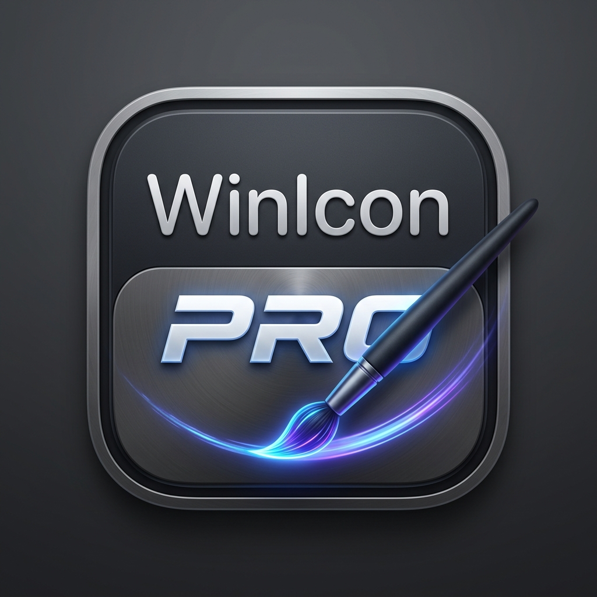

# WinIcons Pro

<p align="center">
  
</p>

<p align="center">
  <strong>Modern Minimalist & Titanium Desktop Icon Styling for Windows 10 & 11</strong>
</p>

<p align="center">
  
  
  
</p>

---

**WinIcons Pro** is a lightweight, zero-dependency utility for Windows 10 and Windows 11 that brings modern minimalist desktop icon styling and sleek duotone tinting to your desktop icons exclusively, keeping your File Explorer, Taskbar, and Start Menu untouched.

## ✨ Features

- **Desktop-Isolated Customization**:
  Only affects icons directly on your User and Public Desktops (`%USERPROFILE%\Desktop` & `C:\Users\Public\Desktop`). Windows Explorer windows and taskbar icons remain in their default system appearance.
- **Minimalist & Duotone Tint Styles**:
  - **Dark Titanium**: Deep titanium matte base (`#18181C`) with crisp platinum/silver glyph highlights.
  - **Tinted Palette**: Smooth duotone color mapping across 8 curated presets (Electric Blue, Emerald, Sunset Orange, Neon Rose, Purple, Gold, Cyan) or any custom `#HEX` color.
  - **Pure B&W**: High-contrast black and white styling.
  - **Inverted**: Negative color transformation with preserved alpha transparency.
- **Squircle Badges**:
  Optional rounded frosted-glass badge container with micro-hairline borders.
- **Bilingual Interface**:
  Switch instantly between English and Russian (`English` / `Русский`) at any time.
- **Dark & Light Mode**:
  Built-in theme switcher supporting both deep graphite dark mode and crisp Fluent light mode.
- **Real-Time Live Preview**:
  Instantly previews changes across all your desktop shortcuts in real time before applying.
- **Self-Healing 1-Click Restore**:
  Intelligently sweeps desktop shortcuts and reverts any customized icons back to their original target executables in one click.
- **Zero Dependencies**:
  Runs out-of-the-box on clean Windows 10/11 installations without requiring external runtimes, packages, or SDKs.

---

## 🚀 Quick Start

1. Download or compile **`WinIconsPro.exe`**.
2. Run `WinIconsPro.exe` (run with administrator privileges to modify system desktop shortcuts).
3. Select your desired mode (**Dark Titanium**, **Tinted**, **Pure B&W**, or **Inverted**).
4. Choose an accent color or fine-tune contrast and brightness in the live preview grid.
5. Click **✨ Apply to Desktop**.

To revert back at any time, click **↩ Restore Defaults**.

---

## 🛠️ Building from Source

The project compiles with the built-in Microsoft C# compiler (`csc.exe`) included with Windows:

```cmd
build.bat
```

No Visual Studio installation or external package managers required.

---

## 📄 License

This project is licensed under the [MIT License](LICENSE).
